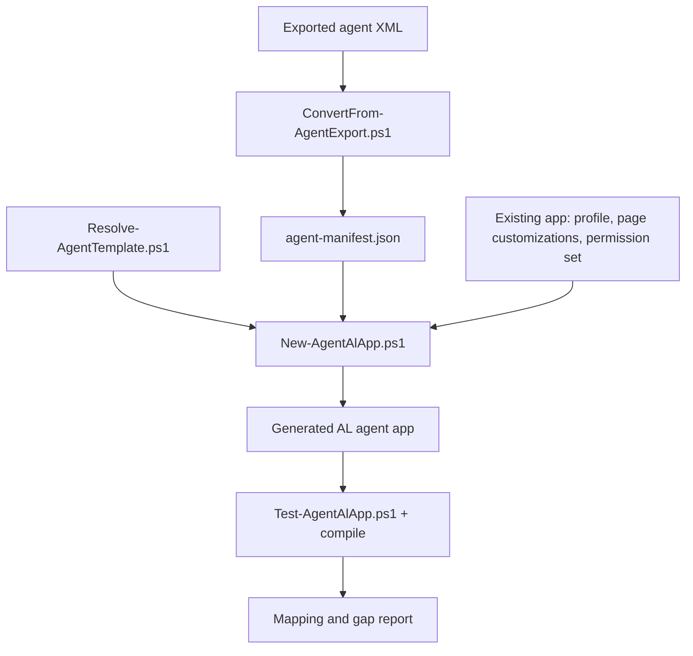

# BC designed agent to AL

Turns an exported designed-agent XML file into a real AL app, starting from Microsoft's own
Agent project template, instead of hand-translating the export by reading it and re-typing
labels into a freshly started template project.

Read `reference/mapping.md` before running anything non-trivial by hand — it documents the
exact, decompiled placeholder-substitution algorithm the AL extension itself uses, the
object-ID map inside the template, and the six things a naive hand-translation gets wrong.
Read `reference/gotchas.md` for the operational checklist while you run the scripts.

## When to use this skill

- The user has an exported agent XML (`<Agents><Agent>...</Agent></Agents>`) and wants an AL
  app for it.
- The user asks to "productionize", "convert to AL", or "package" a designed agent built in
  the no-code Agents UI.
- You are writing or reviewing the "AL app for the designed agent" part of a Business Central
  AI chapter or tutorial and need working, verified example code instead of prose.

## Pipeline



## How to run it

Single entry point, orchestrates the rest:

```bash
pwsh -NoProfile -File "scripts/Convert-AgentExportToAl.ps1" \
  -ExportXml "/path/to/AGENT-agent.xml" \
  -TargetFolder "/path/to/output/Agent App" \
  -StartId 50900 \
  -Publisher "Packt"
```

Add `-DependencyAppId/-DependencyAppName/-DependencyAppPublisher/-DependencyAppVersion` when
the profile, page customizations, or permission set referenced by the export live in another
app that the generated agent app must depend on (see `reference/mapping.md` § 6, gotcha 3).

### Adding the agent into an existing app instead of a new one

Pass `-ExistingAppFolder <path to the app root>` instead of `-TargetFolder` to add the
agent's objects into an app that already exists, rather than scaffolding a brand-new
standalone app:

```bash
pwsh -NoProfile -File "scripts/Convert-AgentExportToAl.ps1" \
  -ExportXml "/path/to/AGENT-agent.xml" \
  -ExistingAppFolder "/path/to/Room Planning" \
  -AgentFolderName "Agent" \
  -StartId 50828 \
  -ReuseExistingProfile
```

This is the right choice whenever the profile, role center, page customizations, and
permission set the export references were already hand-built directly inside the same app
the agent's business logic lives in (this book's own Chapter 6 – Room Planning app is
exactly this case: `src/Agent/Permissions` and `src/Agent/Profile` already exist there
before this skill ever runs). See `reference/mapping.md` § 9 for the full mechanics
(object-ID validation against the existing app's own `idRanges`, namespace detection, and
why `-ReuseExistingProfile` in this mode needs no `-DependencyApp*` at all — the existing
app is its own dependency).

Each stage is also directly runnable and independently testable — a coding agent can call
just the stage it needs instead of the whole pipeline:

```bash
pwsh -NoProfile -File "scripts/ConvertFrom-AgentExport.ps1" -ExportXml <path> -OutFile agent-manifest.json
pwsh -NoProfile -File "scripts/Resolve-AgentTemplate.ps1" -OutFile template-path.json
pwsh -NoProfile -File "scripts/New-AgentAlApp.ps1" -ManifestFile agent-manifest.json -TemplatePath <path> -TargetFolder <path> -StartId 50900
pwsh -NoProfile -File "scripts/Test-AgentAlApp.ps1" -AppFolder <path>
```

Every script prints a human-readable summary to the console and returns a machine-readable
PSCustomObject, so a coding agent can consume either form. **By default, nothing is written to
disk except the generated AL app itself** — no template-resolution dump, no manifest, no
scaffold/verify report. That keeps the generated project a clean AL workspace: `app.json`,
`.gitignore`, `README.md`, `.resources/`, `src/`, nothing else. Pass `-ReportsFolder <path>` to
`Convert-AgentExportToAl.ps1` (or `-OutFile <path>` to any individual script) if you explicitly
want those artifacts persisted as JSON, for example to hand them to someone who cannot re-run
the pipeline themselves. With `-ExistingAppFolder` (see below), that statement narrows even
further: the *only* things this skill adds to disk are `src/<AgentFolderName>/` and
`.resources/` inside the app you already have — its own `app.json`/`.gitignore`/`README.md`
are never touched.

## Workflow

1. **Preflight.** Confirm `pwsh` is 7.0+. If not, stop and tell the reader to install
   PowerShell 7 — do not try to work around 5.1's missing `$IsWindows`/`$IsMacOS`.
2. **Resolve the template.** Run `Resolve-AgentTemplate.ps1`. It checks the local AL
   extension install first, falls back to downloading the official Marketplace VSIX, and
   finally asks for a manual path. Never vendor template files into this repo — the AL
   extension ships under Microsoft's proprietary license terms.
3. **Parse the export.** Run `ConvertFrom-AgentExport.ps1` against the XML. Read the printed
   summary: agent name, display name, access controls (with their App IDs), profile
   reference (with its App ID), localization settings, and any object IDs referenced inside
   `` blocks in the instructions.
4. **Decide the dependency question.** If the profile's `AppID` differs from the app you're
   about to generate, decide now: does the new agent app depend on that app, or do the
   profile/page customizations/permission set move into the new app? Pass the right
   `-Dependency*` parameters to the next step either way — see `reference/gotchas.md`. If
   the profile's `AppID` *is* the app that already owns your business logic (the profile
   was hand-built there, not exported into its own app), consider `-ExistingAppFolder`
   instead of a new standalone app — see "Adding the agent into an existing app" above.
5. **Decide the real trigger page and its real business verb.** The template's example
   page action starts wired to `Customer Card` with generic "Assign Agent Task" wording.
   Read the agent's `<Description>` and the object IDs referenced in its instructions to
   find the page where a user should actually start a task (for the Room Planning Agent,
   that's `Job Card`; for a sales-validation agent, `Sales Order List`), and pick the real
   business verb for the action (`"assign rooms"`, `"validate orders"`, ...). Pass
   `-TaskTriggerPageName` (plus `-TaskTriggerPageNamespace`/`-TaskTriggerKeyField`/
   `-TaskTriggerCaptionField` as needed) to the next step. This mechanical wiring only fixes
   the target page and field names — plan to manually rewrite the action's identifier,
   `Caption`, `ToolTip`, and labels afterward (step 7) to speak that real verb, the way
   Microsoft's own `SalesValidationAgent` sample names its action `ValidateWithAgent` with
   caption `'Validate with Agent'` instead of anything generic.
6. **Scaffold.** Run `New-AgentAlApp.ps1`. It copies the template, applies the two-pass
   `MyAgent` → real-name rename, renames `app` → `src` and `Example` → `Interaction`, and
   flattens `Setup/{KPI,Metadata,Permissions,Profile,TaskExecution}` into top-level `src/`
   folders (with `Profile/` further split into `Profile/Customizations/` and
   `Profile/RoleCenter/`) to match this book's own AL projects and Microsoft's real, shipped
   agent apps (see `reference/mapping.md` § 5), fills every mapped slot from the manifest,
   and either wires the existing profile/permission set/page customizations or drops in
   generated stand-ins the reader must review — see `reference/mapping.md` for what "filling
   a slot" means for each file. When `-TaskTriggerPageName` is given, it also replaces the
   template's own `OnAction` body: instead of building a fixed message string from `Rec`
   fields with no human involved and routing it through the `...PublicAPI` wrapper, the
   generated action opens a small, freshly generated `...AssignTaskDialog.Page.al`
   (`StandardDialog`) so the user reviews and edits the message before it is sent, then
   calls `Agent Task Builder` directly — Microsoft's own documented pattern for creating
   tasks from page actions, and the same shape as the real, shipped
   `SalesValidationAgent/Interaction/SalesValAgentSalesOrders.PageExt.al` (its own review
   step is a date picker instead of a free-text message, but the "ask the user before
   calling `Agent Task Builder`" structure is identical). See `reference/mapping.md` § 8.
7. **Rewrite the task-trigger action for the agent's real job.** Open the generated
   `src/Interaction/*.PageExt.al` and `...AssignTaskDialog.Page.al`. Rename the action
   identifier, `Caption`, `ToolTip`, dialog caption, and every `Lbl`/`Err`/`Msg` label away
   from the generic "record"/"task"/"message" wording the script produced, using the
   business verb from step 5. Decide whether the generated `...PublicAPI`/
   `...PublicAPIImpl` codeunit pair is even needed — the task-trigger action no longer
   calls it, so delete it unless another AL app needs to create tasks for this agent. See
   `reference/mapping.md` gotcha 7 for the full before/after comparison against
   `SalesValidationAgent`.
8. **Verify.** Run `Test-AgentAlApp.ps1`. It scans for leftover `{{...}}` tokens, leftover
   `TODO:` markers in slots the skill claims to have filled, and leftover `MyAgent`/`My
   Agent` text the rename pass missed, then attempts a real compile if a usable compiler is
   available (prefer the AL MCP server's `al_build`/`al_compile` tools, or VS Code, over a
   bundled `alc.exe` — see `reference/gotchas.md` for why the bundled binary is often not
   directly runnable).
9. **Report.** Hand the reader the printed mapping table and the gap list (profile/page
   customization ownership, object IDs to confirm, the task-trigger rewrite from step 7,
   any dropped or unresolved access control). Do not silently paper over a gap — list it.

## Guardrails

- Do not invent AL APIs or template contents. If a template file's structure is not covered
  in `reference/mapping.md`, read the actual file from the resolved template before writing
  code against it.
- Do not vendor Microsoft's template files into any public repo. Resolve them at run time.
- Do not guess the `UpdateLocalizationSettings` argument order from the XML attribute order
  — see `reference/mapping.md` § 6, gotcha 5.
- Do not append `- CompanyName()` to the agent name unless you also update every exact-name
  lookup downstream (evaluation suites, `FindAgentByUserName`) — see gotcha 6.
- Do not leave the task-trigger action's `Customer`/generic "record"/"task" wording in the
  shipped app. `-TaskTriggerPageName` only fixes the target page and field names; renaming
  the action, `Caption`, `ToolTip`, and labels to the agent's real business verb (step 7,
  `reference/mapping.md` gotcha 7) is not optional polish — a reviewer or end user reading
  "Assign Agent Task" on a page that has nothing to do with the agent's actual job is exactly
  the kind of drift this skill exists to prevent.
- Do not build the task message from `Rec` fields alone and send it without asking the
  user. A task-trigger action that silently manufactures a string is not what any real
  Business Central agent does — the SDK's own documented pattern and every shipped
  first-party agent open a small dialog first so the user supplies or confirms the actual
  input (see `reference/mapping.md` § 8). The scaffold already does this; do not undo it
  by hand-rolling a `StrSubstNo`-only trigger during step 7's rewording pass.
- When something cannot be verified (an object ID, a dependency version, a permission), put
  it in the gap report instead of guessing a value that compiles but is wrong.
- With `-ExistingAppFolder`, never pick `-StartId` by guessing. `New-AgentAlApp.ps1`
  validates it against the existing app's own `idRanges` and against every object number
  already declared anywhere in that app (not just the same object type), and errors out on
  a collision instead of silently generating one — read the error and pick a different
  `-StartId` rather than working around the check.
